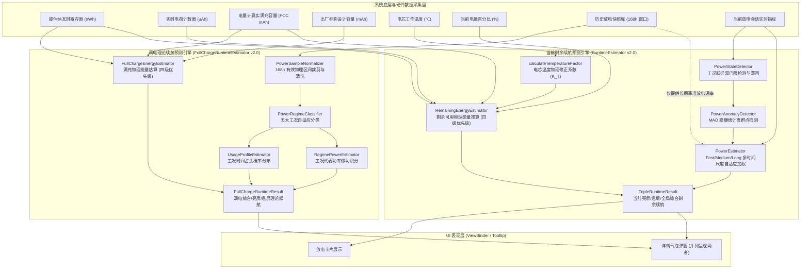

# 电池分析系统：满电续航与剩余续航算法架构与计算逻辑白皮书

本文档系统性阐述 **Battery** 项目中电池理论可用时长预测引擎的核心设计原理、底层数学与物理模型、工况状态机、多时间尺度自适应融合机制以及异常防御体系。

---

## 1. 概述与核心哲学

在移动设备能耗建模中，传统粗放式的“电量计百分比简单换算”往往存在启动尖峰畸变、待机微扰误触发、重载被误杀降权、以及极端温度下严重虚标等固有缺陷。本项目构建了完全基于物理做功守恒的统一续航预测体系：

1. **严格物理守恒（Physical Conservation）**：
   续航时长的物理本质是能量与功率的商，系统所有推导严格遵循物理做功定律：
   $$T = \frac{E_{\text{usable}}}{P_{\text{predicted}}}$$
   严禁脱离实际物理能量与功率，杜绝机械线性推算。
2. **零虚构原则（Zero-Mock & Zero-Fake Data）**：
   严禁捏造假数据、虚拟占位数据或人为的上下限强制钳位（clamp/coerce）。当硬件寄存器不可读或历史统计样本不足时，系统如实向下游返回 `null` 或标识为 `UNAVAILABLE`，界面真实反映“数据不足/未获取”，绝不合成兜底虚假数据。
3. **电芯环境温度物理级修正（Temperature Derating $K_T$）**：
   充分考量锂离子电池在不同温区下的化学活性、等效内阻与可用容量衰减，引入基于电芯实测温度的连续物理衰减系数 $K_T$。
4. **两套体系解耦并列架构**：
   - **满电理论续航（FullChargeRuntime v2.0）**：面向宏观设备能力评估，基于 7 天（168 小时）大样本放电行为库，通过工况分类（Regime Classification）与时间概率分布推导出的典型使用条件下的满电表现。
   - **当前剩余续航（RemainingRuntime v2.0）**：面向微观实时体验，基于设备当前剩余可用物理能量，结合当前放电会话（Fast/Medium）与历史习惯（Long）的多时间尺度自适应预测功率进行微秒级动态预测。

> [!IMPORTANT]
> **核心定调：满电续航与剩余续航相互独立**  
> 满电续航的结果**绝不会**输入到剩余续航的计算流程中，两个算法模型在计算链路上互为并列分支，不存在上下游依赖关系。

---

## 2. 算法总体架构全景



---

## 3. 满电续航算法深度剖析（FullChargeRuntime v2.0）

满电理论续航引擎的核心位于 `com.battery.analysis.domain.estimator.FullChargeRuntimeEstimator`。它通过重构用户过去 168 小时（7 天）的真实放电物理区间，建立工况条件化典型行为模型。

### 3.1 满充可用物理能量估算器（`FullChargeEnergyEstimator`）

遵循系统底层物理数据最高置信度优先级，严禁对已老化的容量进行重复折损：

```
优先级 1：硬件原生纳瓦时能量寄存器 (nativeEnergyNwh)
   └── 若可用且 > 0，结合当前电量百分比反推 100% 满电能量：
       E_full = (nativeEnergyNwh / 10^9) / (batteryPercent / 100.0)

优先级 2：电量计实测真实满充容量 (FCC, Full Charge Capacity mAh)
   └── 由于 FCC 已由电量计库仑计与阻抗跟踪算法动态计入电芯自然老化衰减，
       严禁二次乘以健康度 SOH（杜绝二次惩罚）：
       E_full = (fccMah * nominalVoltage) / 1000.0

优先级 3：电池标称出厂设计容量 (Design Capacity mAh)
   └── 结合实测健康度 SOH 折算：
       E_full = (designCapacityMah * (sohPercent / 100.0) * nominalVoltage) / 1000.0
       (若无有效 SOH，退化为出厂设计标称值并标记为低质量数据)

兜底策略：
   └── 若以上全部缺失或计算结果非法，返回 unavailable（null），严禁硬编码虚拟能量。
```

### 3.2 有效历史区间提取与时间边界裁剪（`PowerSampleNormalizer`）

1. **168 小时时间上限裁剪**：
   系统从历史数据库拉取放电记录，以当前时间点为基准回溯，严格将统计窗口等比截断至有效使用的 168 小时（7 天物理放电时间），避免无限累积历史旧机况。
2. **状态纯净化清洗**：
   - 过滤所有充电区间与插电伪放电状态；
   - 滤除有效持续时长 $< 1$ 秒或功率 $\le 0$ 的物理噪声。

### 3.3 运行工况自适应分类器（`PowerRegimeClassifier`）

为避免绝对功耗门限在不同硬件（如能效旗舰芯片与高刷电竞芯片）上出现水土不服，分类器支持自适应基线：

* **息屏工况判定（Screen-Off）**：
  以设备息屏待机基准底噪 $P_{\text{base,off}}$（默认 0.15W）为基准：
  - **深睡休眠底噪（`OFF_LOW`）**：$P \le 1.5 \times P_{\text{base,off}}$（电芯几乎无负荷，保持底电流）；
  - **唤醒活跃待机（`OFF_HIGH`）**：$P > 1.5 \times P_{\text{base,off}}$（存在后台服务、网络数据同步或音频播放）。
* **亮屏工况判定（Screen-On）**：
  以设备亮屏日常中位功耗 $P_{\text{median,on}}$（默认 1.80W）为基准：
  - **轻载工况（`ON_LIGHT`）**：$P < 0.65 \times P_{\text{median,on}}$（电子书阅读、低亮度纯文本静态展示）；
  - **日常中载（`ON_NORMAL`）**：$0.65 \times P_{\text{median,on}} \le P \le 2.20 \times P_{\text{median,on}}$（日常社交、网页浏览、短视频信息流）；
  - **高负荷重载（`ON_HEAVY`）**：$P > 2.20 \times P_{\text{median,on}}$（高帧率 3D 游戏、相机 4K 连续录像、重度多任务并发）。

### 3.4 行为工况时间占比概率分布（`UsageProfileEstimator`）

传统算法按采样点个数计算比例，会在高频采样的亮屏阶段产生严重偏置。本算法严格遵循**持续物理时间加权守恒**：
$$r_i = \frac{\Delta t_i}{\sum_{k} \Delta t_k}, \quad \sum_{i} r_i \equiv 1.0$$

同时引入近期行为（近 24 小时）与长期习惯（近 168 小时）的温和自适应融合：
$$r_{\text{blended}, i} = (1 - \beta) \cdot r_{\text{long}, i} + \beta \cdot r_{\text{recent}, i}$$
其中 $\beta \in [0.0, 0.20]$（默认 0.15），严格限制近期行为影响上限，防止突发单日行为导致长期习惯模型失真。

### 3.5 工况代表性功率计算（`RegimePowerEstimator`）

针对每一个有效工况分类，其物理代表功率由区间总做功除以总时间积分得出：
$$P_i = \frac{\sum_{k \in \text{Regime}_i} E_k}{\sum_{k \in \text{Regime}_i} \Delta t_k}$$
准入门限：单工况有效覆盖时长必须 $\ge 60$ 秒，否则不确立独立工况。

### 3.6 满电续航综合求解与置信度评级

1. **工况条件化典型功率求解**：
   若有效工况类别覆盖 $\ge 2$ 类，启用行为条件化高阶模型：
   $$P_{\text{typical}} = \sum_{i} r_i \cdot P_i$$
   若工况类别不足，平滑降级至全局物理加权均值基准：
   $$P_{\text{global}} = \frac{E_{\text{history,total}}}{\Delta t_{\text{history,total}}}$$
2. **满电时长求解**：
   $$T_{\text{full,composite}} = \frac{E_{\text{full}}}{P_{\text{typical}}} \times 3600 \times 1000 \quad (\text{ms})$$
   同理，分别提取纯亮屏工况集合与纯息屏工况集合，独立推导得出：
   - **满电亮屏续航**：$T_{\text{full,on}} = \frac{E_{\text{full}}}{P_{\text{typical,on}}}$
   - **满电待机续航**：$T_{\text{full,off}} = \frac{E_{\text{full}}}{P_{\text{typical,off}}}$
3. **置信度等级（Confidence Level）**：
   - `HIGH`：有效历史时长 $\ge 72$ 小时（3天）且工况类别覆盖完整；
   - `MEDIUM`：有效历史时长 $\ge 6$ 小时；
   - `LOW`：有效历史时长 $< 6$ 小时；
   - `UNAVAILABLE`：有效历史时长 $< 10$ 分钟或满充物理能量不可用。

---

## 4. 剩余续航算法深度剖析（RemainingRuntime v2.0）

剩余续航引擎由 `com.battery.analysis.domain.estimator.RuntimeEstimator` 及其组件协同完成，负责回答用户最关心的核心问题：“以当前的使用状态和电量，设备还能撑多久？”

### 4.1 剩余可用物理能量高精度估算（`RemainingEnergyEstimator`）

#### 四级能量源解析优先级
```
策略 1：硬件直接上报剩余能量 (remainingEnergyWh)
   └── 若硬件驱动直接提供且 > 0，经过温度系数 K_T 修正后直接采用。

策略 2：硬件原生纳瓦时能量寄存器 (nativeEnergyNwh)
   └── E_raw = nativeEnergyNwh / 10^9 (Wh)，再乘 K_T 修正。

策略 3：硬件实时电荷计数器 (chargeCounterUah)
   └── 结合电量计中位放电平台电压折算：
       Q_mah = (chargeCounterUah < 100,000) ? chargeCounterUah : chargeCounterUah / 1000.0
       E_raw = (Q_mah * nominalVoltage) / 1000.0

策略 4：有效基准容量 (FCC) 结合剩余百分比推算
   └── E_raw = (fccMah * (batteryPercent / 100.0) * nominalVoltage) / 1000.0
```

#### 电芯温度物理修正系数 $K_T$
锂离子在低温下扩散阻抗急剧增加，高温下副反应加速及内阻生热：
$$K_T(T) = \begin{cases} 
1.0 & 15^\circ\text{C} \le T \le 35^\circ\text{C} \quad (\text{常温稳定区}) \\
0.75 + \left(\frac{T - (-10)}{25}\right) \times 0.25 & -10^\circ\text{C} \le T < 15^\circ\text{C} \quad (\text{低温线性衰减，极寒至 0.75}) \\
0.95 & T > 45^\circ\text{C} \quad (\text{高温轻度损耗}) \\
1.0 & \text{其他边界容差区间}
\end{cases}$$
最终可用物理能量为：
$$E_{\text{usable}} = E_{\text{raw}} \times K_T$$

### 4.2 工况跃迁双门限检测器（`PowerStateDetector`）

为了在微小的息屏波动与剧烈的重载操作之间保持精准平衡，采用工业级**双门限判定机制**：

1. **绝对变化 + 相对变化触发门限**：
   $$\text{Threshold}_{\text{trigger}} = \max\left(\Delta P_{\text{abs,min}}, \text{Ratio}_{\text{change}} \times P_{\text{baseline}}\right)$$
   - $\Delta P_{\text{abs,min}} = 0.35\text{W}$：最小绝对变化硬门限。息屏待机功耗哪怕从 0.20W 波动至 0.30W（相对增幅 50%），但绝对差仅 0.10W $< 0.35\text{W}$，**绝对不误判为工况跃迁**。
   - $\text{Ratio}_{\text{change}} = 0.40$（40%）：相对比例阈值。当功耗从 1.5W 跃升至 3.5W 时，绝对差 2.0W 且相对比率达 133%，连续 2 周期确认后正式触发跃迁激活状态（`isRegimeChanging = true`）。
2. **滞回退出门限（Hysteresis Recovery）**：
   $$\text{Threshold}_{\text{recovery}} = \max\left(0.6 \times \Delta P_{\text{abs,min}}, \text{Ratio}_{\text{recovery}} \times P_{\text{baseline}}\right)$$
   退出容限比设定为 25%，防止功耗在门限边缘反复横跳。
3. **自适应响应倍率**：
   跃迁期间响应倍率 $M_{\text{resp}}$ 动态放大至 1.5 ~ 3.0 倍，使预测模型能够快速跟进新工况。

### 4.3 稳健统计异常功耗检测器（`PowerAnomalyDetector`）

采用中位数与绝对中位差（Median + MAD, Median Absolute Deviation）统计学架构：
$$\text{MAD} = \text{median}\left(\left|P_i - \text{median}(P)\right|\right)$$
标准化离群残差计算公式：
$$Z_i = \frac{\left|P_i - \text{median}(P)\right|}{1.4826 \times \max(\text{MAD}, \text{Floor}_{\text{mad}})}$$
- **短时偶发脉冲抑制**：若 $Z_i > 3.0$，判定为偶发尖峰（如 GC 突发、应用极短冷启动），将其样本置信度降权至 0.15，避免续航数字剧烈跳变。
- **与工况跃迁联动**：若 `PowerStateDetector` 已经确认当前处于持续工况迁移状态（如启动游戏），则**豁免 MAD 离群判定**，权重保持 1.0，防止将真实高负载误杀。

### 4.4 自适应多时间尺度放电功耗估计器（`PowerEstimator`）

模型维持三个并行时间尺度的指数加权移动平均（EWMA）：
* **Fast 尺度（$\tau = 300\text{s}$，~5 分钟）**：捕捉即时操作与当前任务动态；
* **Medium 尺度（$\tau = 1800\text{s}$，~30 分钟）**：刻画当前放电会话的稳态功耗；
* **Long 尺度（近 7 天习惯基准）**：反映用户大样本长期生活作息基线。

#### 动态自适应权重矩阵分配
权重三元组 $(w_{\text{fast}}, w_{\text{medium}}, w_{\text{long}})$ 严格归一化满足 $\sum w = 1.0$：
```
会话持续时长 < 10分钟：
   └── (0.10, 0.20, 0.70) —— 抑制刚拔电冷启动噪声，以长期习惯为主。

会话持续时长 10 ~ 30分钟：
   └── (0.25, 0.30, 0.45) —— 向当前会话平滑过渡。

会话持续时长 30 ~ 60分钟：
   └── (0.40, 0.40, 0.20) —— 当前会话占据绝对主导。

会话持续时长 >= 60分钟：
   └── (0.30, 0.50, 0.20) —— 会话稳态主导。

★ 工况跃迁激活时特殊修正：
   └── w_fast *= (2.5 * M_resp)    (大幅提升敏捷响应)
   └── w_medium *= 1.5
   └── w_long *= 0.15              (强力压制长期惯性拉扯)
```
预测功率由加权和求解：
$$P_{\text{predicted}} = w_{\text{fast}} P_{\text{fast}} + w_{\text{medium}} P_{\text{medium}} + w_{\text{long}} P_{\text{long}}$$

### 4.5 三维度剩余续航统一预测（`estimateTripleRuntimes`）

一站式输出三个维度的续航预测结果：

1. **持续亮屏剩余续航（Screen-On）**：
   $$T_{\text{rem,on}} = \frac{E_{\text{usable}}}{P_{\text{on,predicted}}}$$
   - **工况预期范围**：
     重载功率上限 $P_{\text{heavy}} = \max(1.8 \times P, 3.5\text{W}) \implies T_{\text{min,on}} = \frac{E}{P_{\text{heavy}}}$；  
     轻载功率下限 $P_{\text{light}} = \min(0.8 \times P, \max(1.0\text{W}, 0.75 \times P)) \implies T_{\text{max,on}} = \frac{E}{P_{\text{light}}}$。
2. **持续息屏待机剩余续航（Screen-Off）**：
   $$T_{\text{rem,off}} = \frac{E_{\text{usable}}}{P_{\text{off,predicted}}}$$
   - 预期范围涵盖高活跃待机（下载/后台）与深度休眠底噪（$0.15\text{W} \sim 0.30\text{W}$）。
3. **全局综合剩余续航（Global Composite）**：
   融合用户真实日常作息的亮屏时间占空比 $r_{\text{on}} \in [0.0, 1.0]$：
   $$P_{\text{global,composite}} = r_{\text{on}} \cdot P_{\text{on}} + (1 - r_{\text{on}}) \cdot P_{\text{off}}$$
   $$T_{\text{rem,global}} = \frac{E_{\text{usable}}}{P_{\text{global,composite}}}$$
4. **低电量置信度抑制机制**：
   当剩余电量 $< 10\%$ 时，由于锂电池放电曲线末端极化内阻急剧攀升、压降陡峭，模型将置信度统一乘以 $0.80$ 衰减系数，如实向用户提示预测不确定性。

---

## 5. 满电续航与剩余续航的深度对比与解耦验证

### 5.1 核心维度对比矩阵

| 特性 | 满电理论续航（v2.0） | 当前剩余续航（v2.0） |
| :--- | :--- | :--- |
| **物理求解目标** | 电池总能量在典型作息下的满电总时长 | 电池当前剩余能量在当前工况下的剩余可用时长 |
| **能量物理依据** | $E_{\text{full}}$（硬件 nWh、FCC 或设计标称容量） | $E_{\text{remaining}}$（实时 uAh、nWh 或当前电量折算）$\times K_T$ |
| **功耗物理依据** | 168 小时工况聚类与概率加权典型功耗 $P_{\text{typical}}$ | Fast(5m) + Medium(30m) + Long(7d) 多时间尺度预测功率 |
| **抗突变特性** | **高惯性、高稳定性**，过滤短期单次波动 | **高敏捷、自适应**，双门限瞬时感知工况跃迁 |
| **温度修正** | 针对宏观标称容量（不随瞬时温度跳变） | 引入实时电芯温度物理衰减系数 $K_T$ |
| **工况范围预期** | 输出单一典型评估值与置信度评级 | 输出预期范围（重载极值 ~ 轻载极值） |
| **输出实体** | `FullChargeRuntimeResult` | `TripleRuntimeResult` / `RuntimeEstimate` |

### 5.2 为什么剩余续航不采用“满电续航 × 剩余百分比”？

很多简易系统会采用 $T_{\text{remaining}} = T_{\text{full}} \times \text{Percent}$ 的方式计算剩余续航，但在工程实践中这会导致严重问题：
1. **违背瞬时工况真实性**：
   用户满电续航可能是 10 小时（基于日常刷网页与待机）。但此时如果用户正在运行 3D 游戏（功耗 4.5W），剩余 50% 电量时如果直接乘以 50% 预测还能用 5 小时，会在不到 1 小时内迅速电量耗尽关机，造成极其恶劣的体验崩溃。
2. **违背锂电温度物理特质**：
   在冬季室外（-5℃）环境下，电池实际可释放化学能只有常温的 75% 左右。若按满电续航直接折算，会造成电量断崖跳水。
3. **容错隔离机制**：
   当新设备刚安装应用，历史记录尚不足 10 分钟时，满电续航会忠实返回 `null`（未知）。如果强行绑定依赖，将导致剩余续航也无法显示。解耦后，剩余续航只需基于当前会话实时功率即可快速独立完成推算。

---

## 6. 零假数据边界防御体系与异常处理标准

系统全局严格贯彻零虚构原则，在代码全链路中建立了坚固的防御屏障：

1. **不可用向上如实抛出**：
   - 能量缺失时：`UsableRemainingEnergyEstimate.usableEnergyWh = null`
   - 功率缺失时：`RuntimeEstimate.predictedPowerWatts = null`
   - 时长无法计算时：`remainingMs = null`
   - UI 展现层：忠实展示 `--` 或 `未知`，绝不生成随机数或预设保底假时长。
2. **杜绝二次老化衰减扣除**：
   系统在计算满充能量时，明确界定若使用电量计底层的 FCC，由于硬件底层库仑计与阻抗跟踪算法已动态包含了循环衰减，绝对不进行二次 `* SOH` 惩罚。
3. **物理有效性硬校验**：
   所有计算环节中的浮点数运算均经过 `isFinite()` 与 `> 0.0` 严格校验，杜绝 `NaN`、`Infinity` 或负数时长污染整个状态机。

---

## 7. 结语

本电池续航评估体系通过**满电理论续航（宏观能力）**与**当前剩余续航（微观预测）**的彻底解耦与精细化建模，在保障系统极端高可靠性的同时，忠实反映系统底层与硬件物理本质，实现了工业级的预测稳定性与响应敏捷度。
